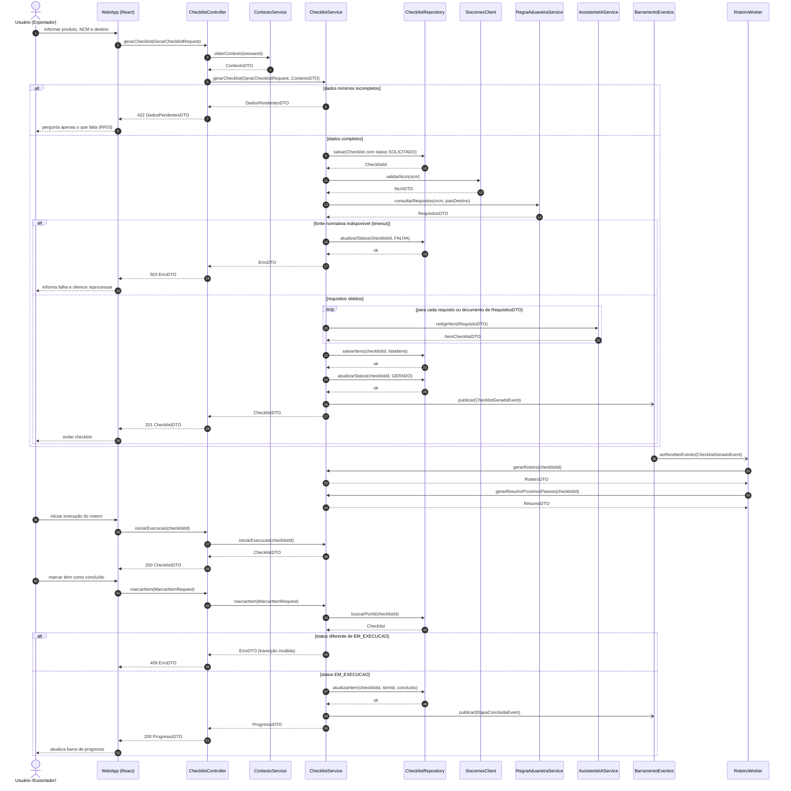
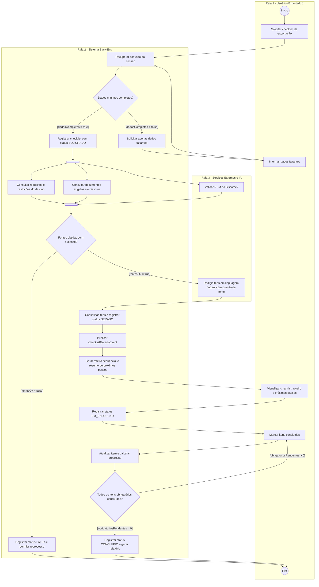
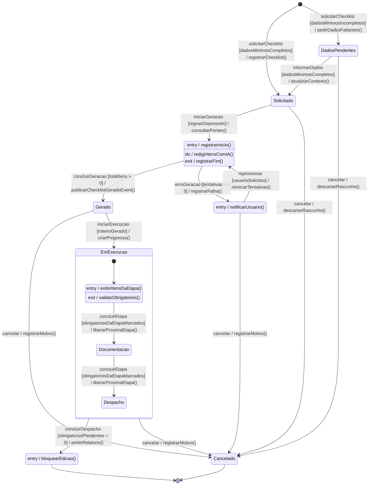
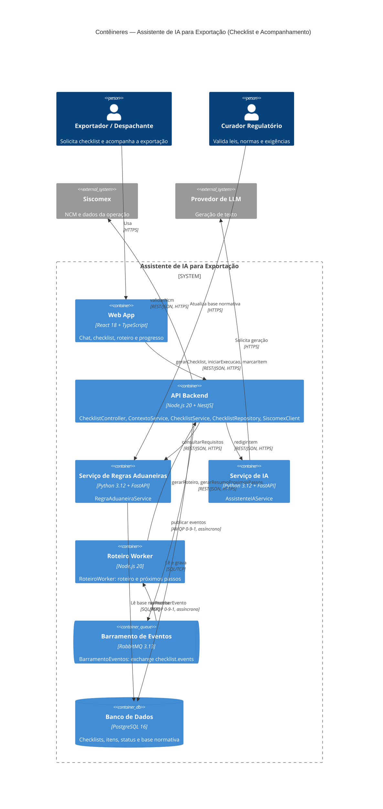

# APS 3 — Dossiê de Arquitetura Viva: Checklist e Acompanhamento da Exportação

**Autor:** Nome Sobrenome
**Projeto:** Assistente de IA para Exportação (Sistema Fiep)
**Funcionalidade crítica:** Geração de checklist e acompanhamento da exportação
**Requisitos relacionados:** RF13 (Resumo de próximos passos), RF14 (Checklist de exportação), RF15 (Roteiro de exportação). Apoio de RF02, RF03, RF04–RF09, RF10 e RF11.

## 1. A funcionalidade

Pequenas indústrias têm dificuldade de entender as exigências aduaneiras. Depois de informar **produto, NCM e país de destino**, o exportador recebe:

1. **Checklist verificável (RF14):** documentos e procedimentos exigidos, cada item com finalidade, emissor, momento de emissão e fonte citada.
2. **Roteiro sequencial (RF15):** o mesmo checklist ordenado em etapas (*Preparação → Documentação → Despacho*), com dependências.
3. **Resumo de próximos passos (RF13):** lista objetiva do que fazer a seguir.
4. **Acompanhamento:** o usuário marca os itens e o sistema calcula o progresso até a conclusão.

É uma funcionalidade crítica porque um checklist incorreto ou fora de ordem pode gerar multa, retenção de carga ou erro fiscal. Por isso o ciclo de vida do checklist é protegido por uma máquina de estados e as fontes são citadas.

A entidade de domínio principal é o **Checklist**, que se liga às classes do diagrama de classes do semestre: `Produto`, `Simulador_exportacao`, `RegraAduaneira`, `RequisitoExportacao`, `RestricaoExportacao`, `DocumentoExportacao` e `FonteNormativa`.

## 2. Estrutura do repositório

```
aps3-nome-sobrenome/
├── docs/
│   ├── architecture/
│   │   ├── workspace.dsl      # C4 nível 2 em Structurizr DSL
│   │   └── adr-0001.md        # ADR 0001
│   └── diagrams/
│       ├── sequencia.mmd
│       ├── atividades.mmd
│       └── estados.mmd
└── README.md
```

## 3. Artefato 1 — Diagrama de Sequência

Convenções do Mermaid usadas aqui:

- `->>` é chamada **síncrona bloqueante**.
- `-)` é chamada **assíncrona** (mensageria), a notação de assíncrono do Mermaid (o `-\>` do enunciado).
- `-->>` é retorno de dados com **DTO**.
- Fragmentos combinados: `alt/else` (dados incompletos, falha de fonte, estado inválido) e `loop` (um item por requisito).



### Regra de consistência: mensagem → operação pública

| Linha de vida (classe) | Operações públicas | Mensagens recebidas no diagrama |
|---|---|---|
| `ChecklistController` | `gerarChecklist(GerarChecklistRequest): ChecklistDTO`, `iniciarExecucao(UUID): ChecklistDTO`, `marcarItem(MarcarItemRequest): ProgressoDTO` | 1.ª, 1.ª e 1.ª de cada fluxo vindas da UI |
| `ContextoService` | `obterContexto(sessaoId): ContextoDTO` | `obterContexto` |
| `ChecklistService` | `gerarChecklist(req, ctx): ChecklistDTO`, `gerarRoteiro(UUID): RoteiroDTO`, `gerarResumoProximosPassos(UUID): ResumoDTO`, `iniciarExecucao(UUID): ChecklistDTO`, `marcarItem(req): ProgressoDTO` | os mesmos nomes |
| `ChecklistRepository` | `salvar`, `salvarItens`, `atualizarStatus`, `buscarPorId`, `atualizarItem` | os mesmos nomes |
| `SiscomexClient` | `validarNcm(ncm): NcmDTO` | `validarNcm` |
| `RegraAduaneiraService` | `consultarRequisitos(ncm, paisDestino): RequisitosDTO` | `consultarRequisitos` |
| `AssistenteIAService` | `redigirItem(RequisitoDTO): ItemChecklistDTO` | `redigirItem` |
| `BarramentoEventos` | `publicar(Evento)` | `publicar(ChecklistGeradoEvent)`, `publicar(EtapaConcluidaEvent)` |
| `RoteiroWorker` | `aoReceberEvento(ChecklistGeradoEvent)` | `aoReceberEvento` |

A `WebApp` só envia mensagens e recebe retornos, então não expõe operações públicas.

**DTOs:** `GerarChecklistRequest`, `MarcarItemRequest`, `ContextoDTO`, `DadosPendentesDTO`, `NcmDTO`, `RequisitosDTO`, `RequisitoDTO`, `ItemChecklistDTO`, `ChecklistDTO`, `RoteiroDTO`, `ResumoDTO`, `ProgressoDTO`, `ErroDTO`.

## 4. Artefato 2 — Diagrama de Atividades com Raias

Há três raias: **Usuário**, **Sistema Back-End** e **Serviços Externos e IA**. O **Fork** inicia três tarefas paralelas (requisitos do destino, documentos exigidos e validação do NCM no Siscomex), e o **Join** só libera o fluxo quando as três terminam. As guardas de cada decisão são mutuamente exclusivas.

> O Mermaid não tem swimlane nativo, então as raias são `subgraph`. Fork e Join usam `shape: fork` e `shape: join` (Mermaid 11.3 ou superior).



## 5. Artefato 3 — Diagrama de Transição de Estados

Entidade: **Checklist**. Os estados são `DadosPendentes`, `Solicitado`, `Gerando`, `Gerado`, `Falha`, `EmExecucao` (com os subestados `Preparacao`, `Documentacao` e `Despacho`), `Concluido` e `Cancelado`. Os estados terminais são `Concluido` e `Cancelado`.

As transições seguem o formato `Gatilho [Guarda] / Ação()`, e `Gerando`, `Falha`, `Preparacao` e `Concluido` têm ações internas (`entry /`, `do /`, `exit /`).



### Proteção contra estados inválidos

| Operação | Estado exigido | Se violado |
|---|---|---|
| `marcarItem` | `EmExecucao` | `ErroDTO` com HTTP 409 |
| `iniciarExecucao` | `Gerado` e roteiro pronto | HTTP 409 |
| `reprocessar` | `Falha` | HTTP 409 |
| qualquer alteração | `Concluido` ou `Cancelado` | bloqueada (estado terminal) |
| `concluirEtapa` | todos os obrigatórios da etapa marcados | permanece na etapa |

## 6. Artefato 4 — Visão de Contêineres C4 (Nível 2)

Diagrama em Mermaid (renderiza no GitHub). O mesmo modelo está em Structurizr DSL em [`docs/architecture/workspace.dsl`](docs/architecture/workspace.dsl).



## 7. Artefato 5 — ADR 0001

#### ADR 0001 — Mensageria assíncrona com RabbitMQ para eventos do checklist

**Status:** Aprovado

### Contexto

Após gerar o checklist (RF14), o sistema precisa produzir o roteiro sequencial (RF15)
e o resumo de próximos passos (RF13). Também precisa reagir a eventos de acompanhamento
(etapa concluída, checklist concluído). Essas tarefas envolvem leitura de dependências entre
etapas e, eventualmente, chamadas à IA. Executá-las de forma síncrona dentro da requisição
HTTP aumentaria a latência percebida pelo exportador e acoplaria a disponibilidade do
checklist à disponibilidade dessas rotinas. Além disso, a geração depende de fontes externas
(Siscomex e LLM), sujeitas a lentidão e falhas, e é preciso garantir que nenhum evento seja
perdido.

### Decisão

Adotar **RabbitMQ 3.13 (AMQP 0-9-1)** como barramento de eventos entre o `ChecklistService`
(produtor) e o `RoteiroWorker` (consumidor). Serão usados:

- exchange `topic` `checklist.events` com as routing keys `checklist.gerado` e `etapa.concluida`;
- filas duráveis com mensagens persistentes e *acknowledgement* manual;
- *dead-letter queue* (`checklist.events.dlq`) após 3 tentativas de reprocessamento;
- consumidores idempotentes, usando `checklistId` + `versao` como chave de deduplicação.

As chamadas que exigem resposta imediata ao usuário (gerar checklist, marcar item)
continuam **síncronas** via REST/HTTPS. Apenas a geração do roteiro e do resumo é desacoplada.

**Por que RabbitMQ e não Kafka ou chamada direta?**
O volume é baixo (consultas de pequenas indústrias). O RabbitMQ oferece roteamento por tópico, DLQ e
confirmação por mensagem com operação simples. O Kafka seria superdimensionado, e a chamada direta
manteria o acoplamento temporal.

### Consequências

**Vantagens**
- Resposta mais rápida ao usuário, porque o roteiro é gerado em segundo plano.
- Isolamento de falhas: se o worker cair, as mensagens ficam na fila e o checklist continua disponível.
- Escalabilidade horizontal do worker sem alterar a API.
- Rastreabilidade: eventos duráveis e DLQ facilitam a auditoria.

**Débitos e riscos aceitos**
- Consistência eventual: o roteiro pode aparecer alguns segundos depois do checklist, e a UI deve tratar o estado "gerando roteiro".
- Nova peça de infraestrutura a operar, monitorar e proteger (TLS, credenciais, backup de definições).
- Entrega *at-least-once* exige consumidores idempotentes, o que aumenta a complexidade do código.
- Risco de mensagens envenenadas, mitigado pela DLQ e por alertas.

## 8. Consistência entre os modelos

| Elemento | Sequência | Atividades | Estados | C4 |
|---|---|---|---|---|
| Validar NCM | `SiscomexClient.validarNcm` | "Validar NCM no Siscomex" | guarda `regrasDisponiveis` | `API → Siscomex` |
| Consultar requisitos | `RegraAduaneiraService.consultarRequisitos` | "Consultar requisitos e restrições do destino" | `Solicitado → Gerando` | `API → Serviço de Regras` |
| Redigir itens | `AssistenteIAService.redigirItem` (loop) | "Redigir itens em linguagem natural" | `do / redigirItensComIA()` | `API → Serviço de IA` |
| Publicar evento | `-) publicar(ChecklistGeradoEvent)` | "Publicar ChecklistGeradoEvent" | `Gerando → Gerado` | `API → RabbitMQ` |
| Roteiro e próximos passos | `RoteiroWorker` chama `gerarRoteiro` | "Gerar roteiro sequencial e resumo" | `Gerado → EmExecucao` (guarda `roteiroGerado`) | `Worker → API` |
| Falha de fonte | `alt` com `FALHA` | `B8` "Registrar FALHA" | `Gerando → Falha` | n/a |
| Marcar item | `marcarItem` com `alt` por status | "Atualizar item e calcular progresso" | só em `EmExecucao` | `Web App → API` |

## 9. Como renderizar

- **Mermaid:** o GitHub renderiza os blocos acima. Localmente, use `npx @mermaid-js/mermaid-cli -i docs/diagrams/sequencia.mmd -o sequencia.svg`.
- **Structurizr DSL:** `docker run -it --rm -p 8080:8080 -v $PWD/docs/architecture:/usr/local/structurizr structurizr/lite`.
